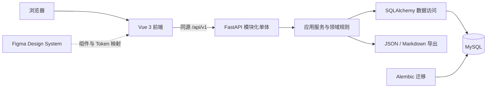

# LearnFlow v1 系统架构

| 信息 | 内容 |
| --- | --- |
| 版本 | 1.1 |
| 日期 | 2026-10-28 |
| 状态 | 阶段 1 工程脚手架已实现并验证；业务模块、数据模型和本机交付仍按后续任务实施 |
| 功能依据 | [FEATURES.md](FEATURES.md)、[PRD v1.5](docs/product/learnflow-v1-prd.md) |
| 设计依据 | [UI 架构](docs/design/ui-architecture.md)、[组件映射](docs/design/component-map.md) |

本文把已确定的功能转化为工程结构和数据一致性方案。技术实现中的新增选择标记为“本架构选择”，不把它们描述成已经开发或验证的事实。业务规则以功能规格为准；决策及剩余验证见第13节。

## 1. 架构目标与边界

- 先交付可持久化的个人学习闭环，再逐步完善今日安排、异常恢复和配套能力。
- 规则集中在服务端，前端不独立计算复习排程或决定归档对象能否修改。
- 按业务模块组织代码，使复习算法、UI 组件、接口与数据库可以独立演进。
- 默认本机单用户、单工作空间、无登录；公网与多用户不在本版支持范围。
- 第一版不引入微服务、Redis、消息队列、搜索集群或定时排程服务。

### 总体结构



这是传统前后端分离应用。Figma 不参与运行时；浏览器不连接数据库，外部学习链接由浏览器打开，API 不抓取其内容。

## 2. 技术选择

| 层 | 方案 | 职责与边界 |
| --- | --- | --- |
| 前端基础 | Vue 3、TypeScript、Vite、Vue Router | 页面、路由与构建 |
| 基础 UI | shadcn-vue、Reka UI | 可维护组件源码、适用的无头交互与可访问性 |
| 样式与图标 | Tailwind CSS、Lucide | 语义变量、布局、SVG 图标 |
| 服务端状态 | TanStack Vue Query | 查询缓存、请求状态、写入后失效重取 |
| 前端本地状态 | 组件状态；必要时 Pinia | 弹窗、草稿等跨组件状态，不复制全部服务端数据 |
| API | Python、FastAPI、Pydantic | 输入输出校验、OpenAPI、错误适配 |
| 数据访问 | SQLAlchemy + PyMySQL | 本架构选择同步数据库访问，简化首版事务管理 |
| 数据库与迁移 | MySQL、InnoDB、utf8mb4、Alembic | 持久化、事务、约束和迁移 |
| 测试 | pytest、Vitest、Vue Test Utils、Playwright | 分别覆盖规则、前端逻辑、组件行为和端到端流程 |
| 本地环境 | Docker Compose | 数据库及完整应用的可复现启动 |

依赖具体版本由实现阶段兼容性检查与锁文件确定。本架构不指定未经验证的“最新版”。服务端状态缓存选择参考 [TanStack Vue Query 官方说明](https://tanstack.com/query/latest/docs/framework/vue/overview)。

同步 SQLAlchemy 操作放在同步 FastAPI 路由及服务调用链中；不在 `async def` 内直接执行阻塞数据库访问。每个请求建立独立 Session，不跨请求或并发任务共享；写事务由应用服务明确开启、提交或回滚，仓储不自行提交。参见 [FastAPI 并发说明](https://fastapi.tiangolo.com/async/)与 [SQLAlchemy Session 说明](https://docs.sqlalchemy.org/en/20/orm/session_basics.html)。

## 3. 仓库结构

以下是待创建的目录，不表示当前仓库已有代码。

```text
LearnFlow/
├── FEATURES.md
├── ARCHITECTURE.md
├── apps/
│   ├── web/
│   │   ├── src/
│   │   │   ├── app/                 路由、应用初始化、QueryClient
│   │   │   ├── features/            today/topics/resources/tasks/notes/reviews/settings/exports
│   │   │   ├── components/ui/       shadcn-vue 基础组件
│   │   │   ├── components/learning/ 业务组合组件
│   │   │   ├── lib/                 API适配、时间显示、Markdown
│   │   │   └── styles/              语义CSS变量、Tailwind入口
│   │   └── tests/
│   └── api/
│       ├── app/
│       │   ├── main.py
│       │   ├── core/                配置、时钟、错误、日志
│       │   ├── db/                  Engine、Session、公共模型
│       │   └── modules/             与前端业务模块对应
│       ├── migrations/             Alembic
│       └── tests/
├── packages/api-client/             从OpenAPI生成，不手工维护类型副本
├── docs/
│   ├── product/
│   ├── design/
│   └── architecture/                ADR、接口及数据设计补充
└── infra/                           Compose、容器构建、反向代理、配置示例
```

一个后端业务模块按实际复杂度组织 `router.py`、`schemas.py`、`service.py`、`repository.py`、`models.py`。简单模块可以合并文件，不为每个实体创建抽象接口或通用 CRUD 框架。

## 4. 后端分层与模块职责

依赖方向为 Router → Service → Repository/Model；纯规则模块不依赖 HTTP、数据库或浏览器。

| 层 | 负责 | 不负责 |
| --- | --- | --- |
| Router / Schema | 请求解析、基础字段校验、响应与错误映射 | 排程、跨记录事务 |
| Service | 状态资格、关联校验、事务边界、模块协作 | 页面布局 |
| Domain policy | 固定间隔计算、今日候选排序及估时 | 查询数据库、系统实时时钟读取 |
| Repository / Model | 查询、锁、持久化与约束 | 独立提交业务事务 |

| 模块 | 主要职责 | 协作关系 |
| --- | --- | --- |
| topics | 主题 CRUD、暂停、归档、恢复资格 | 提供主题状态校验；子项写操作共同遵守 |
| resources | 链接与摘录、搜索、阅读状态、归档查询 | 给任务和笔记提供来源摘要 |
| tasks | 任务编辑、主题内排序、完成事件 | today 消费待办与完成快照 |
| notes | Markdown、版本控制、来源关联 | reviews 创建卡片时复制选段，不动态引用答案 |
| reviews | 卡片、暂停恢复、重置、到期查询、评分事务 | 纯策略函数返回阶段与下一次时间 |
| today | 读取候选、统计估时、合并当日覆盖 | 不直接改写任务或卡片状态 |
| settings | 学习时间、学习日、时区 | today 与时间显示使用同一配置 |
| exports | 一致性读取、格式转换和下载 | 不承担数据库恢复 |

跨模块调用服务或明确的查询接口，不经内部 HTTP 互相调用。今日建议属于可重算的读取结果，不建立需要定时同步的“今日任务副本表”。

## 5. 前端结构与状态管理

### 页面与路由

建议页面路由：`/today`、`/topics`、`/topics/:id`、`/resources`、`/resources/:id`、`/notes`、`/notes/:id`、`/review`、`/settings`。具体路由命名可在实现时调整，不改变功能入口。

列表条件放在 URL query，例如资料列表的 `q`、`topic`、`reading`、`archived`、`page`。查询缓存键包含全部有效条件，详情缓存键包含实体 ID。不能用单一 `resourceDetail` 缓存槽承载所有资料。

来源关联列表同时携带来源详情的topic_id与resource_id/note_id，省略topic_status时按API的主题内all语义读取；不从当前全局选中主题推导归属。全局列表仍沿用默认隐藏规则。

- 列表进入详情时保留列表上下文；返回优先使用该上下文，直接打开详情则回到合理默认列表。
- 切换筛选条件回到第一页。无结果保留条件；取消筛选弹窗不写入 query，应用时才提交条件。
- 写入成功后按API.md第11节失效详情、列表、汇总和今日查询。主题暂停/归档/恢复还需覆盖全局及主题内所有受影响的子项列表变体、子项详情/来源摘要和复习队列；作废旧请求，活动查询重取、未挂载查询标失效后下次使用前重取，保留筛选/分页及草稿。其他标签页沿用聚焦/再次进入/状态冲突重取，不新增推送架构。
- 保存、完成、评分不预先显示成功；请求结果未明确时保持待确认状态。
- 网络重试评分复用原幂等键，只有新的一次评分生成新键。

### 表单、草稿与公共组件

表单数据在页面或 composable 中维护；服务端字段错误映射到字段，失败保留输入。笔记草稿建议保存到 IndexedDB，按笔记 ID、新建草稿 ID 和基础版本区分；恢复草稿前提示用户，不自动覆盖服务端新版本。首版没有离线写入同步队列。

草稿采用以下技术协议，服务于既有失败恢复要求，不增加离线同步功能：

- 每次打开编辑器生成独立editor_id（UUID），以“实体ID或新建draft_id + editor_id”为草稿键；保存base_version、local_revision、title、body_markdown、resource_id和本地更新时间。base_version是内容字段而非唯一键，避免同版本双标签页互相覆盖，也便于更新基础版本。
- 编辑后1秒无新输入写入IndexedDB；应用内离页先尝试落盘，仍按未保存提示。浏览器强退不能保证最后1秒落盘，不能把beforeunload当作可靠异步保存机制。IndexedDB不可用、配额不足时保留内存输入并明确显示本地草稿未持久化，仍可手动保存到服务端。
- 重开笔记查询该ID的所有草稿，列出时间、基础版本和预览供选择，不自动合并、覆盖或丢弃其他编辑器的记录。新建草稿单独可恢复；恢复先取最新服务端版本，有冲突保留双方文本。
- 点击保存时捕获文本和local_revision。成功只确认这份已提交快照；若其间输入产生更高revision，更新base_version为响应版本并保留新文本，继续显示未保存。仅当当前revision等于提交revision时清理本编辑器草稿，不删除其他editor_id的草稿。失败与409均保留草稿；显式放弃仅删除用户选中的记录。
- 新建保存成功将仍未提交的新输入关联到响应note_id/version；POST结果未知时保留draft_id及提交快照，按API的创建结果确认规则处理，不因自动重试生成重复笔记。

基础 UI 不认识任务阶段或复习策略。业务组件如 `ResourceFilter`、`LearningTaskItem`、`NoteEditor`、`ReviewCard`、`ReviewRating` 组合基础控件；页面负责路由、查询与操作编排。

Figma Token 映射到 CSS 语义变量，再由 Tailwind 消费。组件规范同步到代码；Figma 预填字段不能冒充可编辑表单，也不能把所有选择器实现为固定示例跳转。Lucide 按需导入，不复制字符图形。

## 6. 逻辑数据模型

### 实体与关键约束

| 表 | 主要字段 | 关键约束或索引 |
| --- | --- | --- |
| settings | singleton_id、daily_minutes、learning_days、timezone、version | 单例；daily_minutes ≥ 5 |
| topics | id、title、goal、priority、status、version、created_at、updated_at | 状态枚举；排序字段索引按查询验证 |
| resources | id、topic_id、title、type、source_description、url、excerpt、reading_status、archived_at、version | FK topic；(topic_id, archived_at, reading_status) |
| tasks | id、topic_id、resource_id、title、estimated_minutes、position、planned_date、status、archived_at、version | FK；正整数估时；(topic_id, status, planned_date, position) |
| notes | id、topic_id、resource_id、title、body_markdown、version、archived_at | FK；主题与归档列表索引 |
| review_cards | id、topic_id、note_id、question、answer、stage、due_at、is_paused、version、policy_version | stage -1～5；(topic_id, is_paused, due_at, id) |
| task_completions | id、task_id、occurred_at、local_date、timezone、estimated_minutes_snapshot | UNIQUE(task_id)；occurred_at 索引 |
| review_events | id、card_id、event_type、rating、old_stage、new_stage、old_due_at、new_due_at、occurred_at、local_date、timezone、policy_version、idempotency_request_id | 追加保存；幂等键经关联取得；(card_id, occurred_at)；occurred_at 索引 |
| daily_overrides | id、local_date、task_id 或 card_id、action、version | 两种目标恰有一个；分别 UNIQUE(local_date, task_id)、UNIQUE(local_date, card_id) |
| idempotency_requests | id、operation、request_key、request_hash、response_status、response_body、created_at | UNIQUE(operation, request_key)；与业务变化同事务提交 |

`archived_at`仅提供保留数据的存储能力，不自动承诺所有对象都有归档/恢复入口。卡片只有无任何review/reset事件时才可删除，不能只看当前阶段。外键默认RESTRICT，不对学习历史配置级联删除。

本架构选择 UUID 的 `CHAR(36)` 表示以便首版调试，UUID 列用一致字符集和二进制比较规则；未来数据规模证明有必要时再评估 `BINARY(16)`。正文、摘录和答案使用文本列，业务长度上限统一采用 FEATURES.md 第2节，物理类型见 DATABASE.md。

可选关联既用外键保证存在，又由服务端验证同主题。相关写操作锁定主题，防止并发迁移造成检查后关系变化；跨主题迁移在产品行为确定前不开放。需要进一步增强时可引入包含 topic_id 的复合外键，但不以它替代业务校验。

`daily_overrides` 不使用无法建立外键的任意 `target_type + target_id`。任务与卡片分别建可空外键，通过数据库约束与服务端校验确保恰好一个非空；实现时验证选定 MySQL 版本对约束的支持。

### 时间与搜索

时间戳使用 `DATETIME(6)` 保存 UTC，Python 服务层使用带 UTC 时区的时间对象；数据库读取与写入适配显式转换，不依赖 MySQL 自动保存时区。连接会话设 UTC；API 输出 ISO 8601 UTC，显示转换由前端统一处理。

任务planned_date保持本地DATE，兼容范围1000-01-01～9999-12-31；前后端按FEATURES/API校验格式、真实日期及范围，禁止先转UTC或依赖数据库报错处理非法输入。该限制不改变今日排序或未来任务手动加入资格。

服务端通过可注入 `Clock.now()` 获取时间，一个操作固定一次业务时间。按当前设置时区计算今日起止边界再换成 UTC 查询事件；保留事件当时本地日期与时区用于追溯。跨夏令时日不能直接按“本地零点 + 24 小时”计算统计窗口；复习策略的“一天”则按规格固定 24 小时。

中文检索首版采用参数化子串查询。关键词按普通文本转义 `%`、`_` 等 LIKE 通配符；资料匹配标题或来源，笔记匹配标题或正文。普通 B-tree 不保证加速前导通配符搜索；先分页并测量，再考虑全文或专用搜索方案。

## 7. 事务、并发与幂等

### 统一写入原则

一次用户命令对应一个服务层事务。需要同时保护主题状态和子项的写操作，按 **主题 → 子实体 → 事件/幂等记录** 的顺序获取锁。同主题写命令在主题行上串行，适合首版本机单用户规模；不同主题仍可并发。若未来出现瓶颈，再细化锁粒度。

主题暂停、归档与子项编辑、完成、评分使用同一主题锁协议。若评分先取得锁，它可完成后再归档；若归档先提交，之后评分必须被资格校验拒绝。这样不会出现“已归档后仍新增一条评分”的检查竞态。锁定读取须在事务中使用，参见 [MySQL locking reads](https://dev.mysql.com/doc/refman/8.4/en/innodb-locking-reads.html)。

唯一键和版本条件是最后防线，不把前端禁用按钮当作一致性方案。死锁或锁超时回滚整个事务；只对明确可安全重试的命令有限重试，不重试已知版本冲突。

### 评分事务

1. 验证请求结构、卡片 ID、评分、版本和 `Idempotency-Key`。
2. 服务层在本请求的 Session 上先显式开启事务，再根据 operation + key 查询已完成请求：内容摘要一致则结束只读事务并返回原响应；同键不同请求返回冲突。重复请求回放优先于当前版本和主题状态检查。
3. 未命中时继续同一事务，锁主题和卡片；再以最新读取检查幂等记录，处理等待期间其他请求已提交的情况。写事务采用 DATABASE.md 的 READ COMMITTED，不能在前置 SELECT 已触发自动事务后再次调用 begin，也不以嵌套事务绕过事务归属问题。
4. 校验主题活动、卡片未暂停且仍到期、请求版本一致；状态改变时返回明确冲突，不更新排程。
5. 用服务端时间和当前阶段调用纯策略函数，计算新阶段与 due_at。
6. 更新卡片和版本，插入复习事件，保存请求摘要与原响应。
7. 一次提交全部变化；提交成功后返回下次时间。

若唯一幂等键碰撞，回滚后用新事务读取已完成结果并比对摘要。不同卡片误用同一键不能得到另一张卡的成功响应。事务失败不保留半完成请求；网络断开但提交成功时，客户端使用原键重试取回结果。

重置复用上述事务框架，写入 reset 事件，但不计评分次数。首版幂等记录不做自动短期清理，避免旧请求在清理后被当作新操作。

### 任务完成、笔记保存与任务排序

- **完成任务**：锁主题和任务；已完成则返回已有完成结果；否则状态和完成快照同事务提交，UNIQUE(task_id) 阻止重复记账。
- **保存笔记**：校验主题可编辑，用 `id + expected_version` 条件更新并递增版本；影响行数为零时区分不存在与版本冲突。本地文本由前端保留，不由服务端覆盖式合并。
- **任务排序**：提交主题版本或排序版本和完整待排序 ID 列表；锁主题，检查 ID 唯一、归属正确、集合符合约定，在同一事务重排 position，防止只保存一半顺序。
- **归档与恢复**：只改变主题级状态及必要元数据，不批量改写子项阶段、暂停标记、完成状态或 due_at。

## 8. 今日安排的计算架构

`TodayService` 在一致的读取视图中获取设置、主题资格、任务候选、到期卡、今日事件和覆盖记录；固定本次 as_of 时间，调用纯 `TodayPlanner` 返回建议。若读取方案使用事务快照，应显式配置并测试隔离级别，不依赖环境默认值。

返回内容包含 `as_of`、时区、本地日期、计划时间、已用估时、剩余时间、到期数量、建议项目、推荐理由和超额提示。公式和排序直接引用 [FEATURES.md 第 9 节](FEATURES.md#9-lf-07-今日学习)，不维护另一套规则副本。

候选选择不能仅取数据库第一页任务，否则会漏掉后续可放入计划时间的任务。首版允许在服务端读取必要的轻量候选字段进行确定性排序；大数据量优化要验证结果等价。显示去重以实体 ID 为准，加入与自动推荐同项不能出现两行或重复扣估时。

前端在进入页面、写入成功、窗口重新获得焦点及跨本地日期后重取；可根据最近 due_at 安排一次刷新，但服务端查询始终重新判断到期。不依赖浏览器一直在线，也不需要后台任务把卡片“改成到期”。

## 9. API 契约

下表为接口设计草案，最终由 Pydantic/OpenAPI 固化；它不表示接口已实现，也不解决未确认的产品行为。

| 资源 | 拟定接口组 |
| --- | --- |
| 主题 | GET/POST `/topics`；GET/PATCH `/topics/{id}`；POST `/topics/{id}/pause`、`/archive`、`/restore` |
| 资料 | GET/POST `/resources`；GET/PATCH `/resources/{id}`；POST `/resources/{id}/archive`、`/restore` |
| 任务 | GET/POST `/tasks`；PATCH `/tasks/{id}`；POST `/tasks/{id}/complete`；PUT `/topics/{id}/task-order` |
| 笔记 | GET/POST `/notes`；GET/PATCH `/notes/{id}` |
| 卡片 | GET/POST `/cards`；GET/PATCH `/cards/{id}`；POST `/cards/{id}/pause`、`/restore`、`/reset`；DELETE 无review/reset事件的卡片 |
| 复习 | GET `/reviews/due`；POST `/cards/{id}/reviews` |
| 今日安排 | GET `/today`；PUT/DELETE `/today/overrides/{kind}/{id}` |
| 设置 | GET/PUT `/settings` |
| 导出 | GET `/exports/topics/{id}`；GET `/exports/notes/{id}` |

所有路径使用 `/api/v1` 前缀。归档资料查询与恢复遵循已确认的FEATURES/API；资料、任务、笔记、卡片列表的topic_status默认规则统一见API.md第1.2节，不能由前端全局状态暗中决定。日期、分页参数和enum在OpenAPI中定义，未知排序字段拒绝而非拼入SQL。

列表返回 `items`、分页信息；排序必须包含 ID 作为稳定次序。详情返回版本与来源摘要，必要时包含可用操作提示；这些提示供 UI 使用，写命令仍重新校验权限和状态。

错误统一为：

```json
{
  "error": {
    "code": "VERSION_CONFLICT",
    "message": "内容已在其他页面更新，请查看最新版本后重试。",
    "field_errors": {},
    "request_id": "...",
    "details": { "current_version": "4" }
  }
}
```

建议状态码：创建 201、成功读取或更新 200、无响应体成功 204、缺失 404、版本/状态/幂等冲突 409、字段校验 422、暂不可用 503。错误码如 `VERSION_CONFLICT`、`TOPIC_NOT_ACTIVE`、`TOPIC_READ_ONLY`、`CARD_NOT_DUE`、`IDEMPOTENCY_KEY_REUSED`；最终枚举纳入契约测试。

## 10. 部署、安全与导出

### 本地开发与交付运行

- development：本机Uvicorn绑定127.0.0.1，Vite代理/api；本机CLI和显式配置的浏览器调试页允许直连API，不依赖Nginx。直连与代理均执行Host/Origin校验，MySQL使用现有Compose。
- production（本机交付）：沿用Nginx容器提供前端静态资源并代理API，实现同源访问；API和MySQL不映射宿主机端口，业务请求仅经Nginx进入内部容器网络。容器内回环健康检查仅允许只读健康端点，不形成业务接口直连例外。
- 宿主机入口绑定 `127.0.0.1`；开发需要直连数据库时也只绑定回环地址。容器内服务可绑定内部地址，不把此配置混同公网开放。
- 数据存放在 MySQL 命名卷；迁移作为单独的一次性步骤执行，成功后再启动新版本 API，不让多个 worker 并发迁移。
- 提供存活与就绪检查；就绪检查覆盖数据库连通和迁移版本，但不暴露连接信息。

配置包括数据库连接、允许来源、默认学习偏好、日志级别和应用环境；示例不含真实密码，密码不进入仓库。公网部署前必须增加认证、授权、TLS 和隔离设计，不能仅修改监听地址就宣称支持多用户。

APP_ENV须显式选择development/production；Host/Origin示例、端口、CORS、可信代理及CLI/健康检查规则统一引用API.md第1.1节，不另维护一套允许列表。仅生产业务入口限制为Nginx；开发直连不是关闭安全校验，环境切换不改变模块或部署架构。

### 输入与浏览器边界

HTTP/HTTPS URL 用结构化解析校验，外链使用新标签页并隔离 opener；后端不抓取 URL。Markdown 渲染禁止不安全 HTML，限制链接协议。写接口接受约定 JSON 请求，验证 Origin/Host 与允许来源；无登录的本地服务仍需防止任意网页向本地接口发起写入，CORS 本身不是身份认证。

Origin/Host、缺失来源、代理转发、OPTIONS与本地CLI调用统一按API.md第1.1节判定，不另设放行分支。请求体上限1MiB；代理错误也须返回约定结构，不能将Nginx的HTML错误页直接交给表单。

### 导出与备份

主题导出在一致性读取事务中取得同一快照，包括归档记录、关联、事件和策略版本。文件包含 `schema_version`、`exported_at` 和时区等元数据；Markdown 文件名处理非法字符，正文保留原内容。

本架构选择先完整生成到内存或受控临时文件，成功后才发送下载响应；失败清理临时内容。首版不做异步导出任务系统；导出schema、8MiB内存转临时文件阈值和可配置128MiB成品上限见API.md第10.2节，属于本次工程默认值，不是用户确认的业务数据容量上限。快照读取完成后关闭只读事务再格式化成品；处理峰值内存与实测性能纳入发布验证，不能因使用临时文件就宣称读取阶段内存无限可控。

数据库备份与业务导出分开。提供mysqldump/mysql说明并在独立空库演练。用户确认的每日备份、7份日/4份周保留及30分钟恢复目标以DATABASE.md第8.3节为准，不新增后台调度或HTTP恢复接口。发布前记录硬件、数据量与实测恢复时间，不把目标写成已达标结果。

## 11. 测试与可观测性

| 层级 | 必须覆盖的风险 |
| --- | --- |
| 纯规则测试 | 所有复习阶段、忘记与模糊、计划取整、排序、超额、时区与午夜 |
| MySQL 集成测试 | 迁移、关联校验、完成唯一性、幂等回放、归档与评分并发、事务回滚 |
| API 契约测试 | OpenAPI 生成结果、错误结构、枚举、版本与幂等参数 |
| 前端行为测试 | 查询键含条件、详情身份、取消与应用筛选、草稿恢复、失败不丢输入 |
| 浏览器端到端 | 真实闭环、归档入口、暂停恢复、来源访问、390px流程、键盘与焦点 |
| 运维演练 | 空库启动、升级迁移、备份与恢复 |

并发测试使用两个独立 Session 和可控同步点，不能仅连续发送两个请求冒充并发验证；事务测试不能只用 SQLite 替代 MySQL。CI 执行前端类型/构建、后端测试、契约检查和关键端到端场景。

结构化日志包含 request_id、操作类型、耗时、结果码；不默认记录笔记正文、卡片答案、数据库密码或完整敏感查询。统计错误率、冲突、锁等待与慢查询用于排查，不引入外部埋点作为首版依赖。

## 12. 实施顺序与演进方式

1. **工程底座**：仓库结构、配置、MySQL、迁移、统一错误、时钟、OpenAPI 客户端和设计变量。
2. **最小真实闭环**：主题、资料、任务、笔记、制卡、反馈；优先实现持久化和关键事务。
3. **完整规则**：今日安排、覆盖、暂停归档恢复、搜索、版本冲突、导出与设置。
4. **发布保障**：键盘、移动端、并发测试、恢复演练和一周试用。

以上是实施顺序，不是工期承诺。规则升级通过策略版本和显式迁移处理；API 兼容变化保持 v1，破坏性变化另定版本；数据库采用新增迁移，避免修改已执行迁移。

当真实指标出现瓶颈，再评估细粒度锁、全文检索、导出后台任务和缓存；不因“可能扩展”提前拆微服务。

## 13. 待决策事项与架构记录

产品决策与剩余验证统一见[实施就绪记录](docs/product/implementation-readiness.md)，业务规则以FEATURES.md为准。主题恢复固定为活动，不加status_before_archive；跨主题移动不开放，不为任务/笔记新增独立归档、恢复或删除入口。架构存储预留不扩展产品范围。

本架构新增选择包括同步 SQLAlchemy/PyMySQL、主题级写锁、幂等请求表、UUID CHAR(36)、TanStack Vue Query、IndexedDB 草稿和 Nginx 同源部署。这些选择可通过 ADR 修订，但须说明影响与迁移方式。

列表页大小与上限、导出阈值、输入边界和备份周期已在专项文档确定。依赖版本组合、连接池、超时、实际备份位置及性能基准在M1/M2落实并实测；发布门禁见实施就绪记录。按钮统一14px Medium与可访问配色，Figma同步及实际控件对比度仍待验证，不继续采用旧19px依据。

本文件不代表系统已经通过测试。每次架构变更同步更新功能影响、接口契约、数据迁移和验收用例，避免文档、原型与代码各自形成不同规则。
