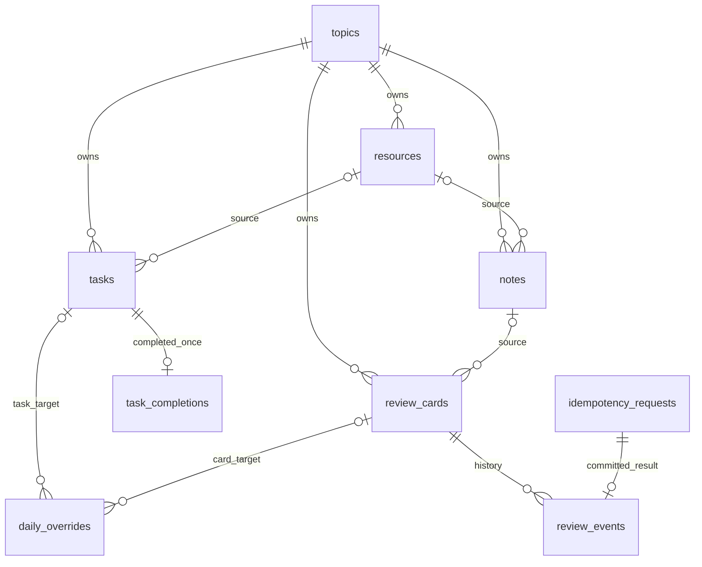

# LearnFlow v1 数据库设计

| 信息 | 内容 |
| --- | --- |
| 版本 | 1.1 |
| 更新日期 | 2026-10-27 |
| 状态 | 拟实施设计；尚未创建数据库、执行迁移或验证 SQL |
| 功能依据 | [FEATURES.md](FEATURES.md) |
| 架构依据 | [ARCHITECTURE.md](ARCHITECTURE.md) |
| 数据库 | MySQL，InnoDB，utf8mb4 |

本文定义第一版的表、字段、关系、约束、索引和写入规则，供 SQLAlchemy 模型、Alembic 迁移和集成测试使用。业务边界以 FEATURES.md 已确认规则为准；物理表示采用本文设计。最终可执行结构以经评审并在真实 MySQL 验证的迁移为准。

## 1. 设计原则

- 单用户、单工作空间，不预建账号、租户或团队权限表。
- 主题是资料、任务、笔记和卡片的归属边界，关联对象必须属于同一主题。
- 当前实体保存当前内容和状态；完成、评分和重置事件独立追加，不能被后续编辑覆盖。
- 暂停或归档通过状态控制生效范围，不批量改写子对象状态，不级联删除历史。
- 今日建议是查询与规则计算结果，不建立“每日推荐副本”，不保存容易失真的累计完成数。
- 事务、唯一约束和版本号共同保证一致性，不依赖前端禁用按钮。

## 2. 物理存储约定

### 2.1 基线与命名

本设计以 MySQL 8.4 文档行为为验证基线，不表示运行环境已经锁定该版本。实现时固定镜像与驱动版本，并验证 CHECK、外键和事务行为。

| 项目 | 约定 |
| --- | --- |
| 库名 | 建议 `learnflow`，由配置决定 |
| 表、字段 | 小写 snake_case；表名与架构模块一致 |
| 主键 | 除 settings 单例外，UUID `CHAR(36) CHARACTER SET ascii COLLATE ascii_bin` |
| UUID 生成 | 服务端生成规范的小写 UUID；不依赖数据库自增顺序 |
| 普通文本 | utf8mb4；建议 `utf8mb4_0900_ai_ci`，搜索大小写等行为需测试确认 |
| 枚举、策略标识、幂等键 | ASCII、区分大小写；使用 VARCHAR + CHECK，不使用数据库 ENUM |
| 时间戳 | `DATETIME(6)`，统一存 UTC，不带隐含时区转换 |
| 本地日期 | `DATE`，用于计划日期和当日覆盖日期 |
| 版本 | `BIGINT UNSIGNED NOT NULL DEFAULT 1`；更新成功递增 |
| 约束命名 | `pk_*`、`uq_*`、`fk_*`、`ck_*`、`ix_*`；在 MySQL 名称长度限制内 |
| 外键动作 | `ON DELETE RESTRICT ON UPDATE RESTRICT`，除非另有明确说明 |

DATETIME 不记录时区。应用负责将带时区时间转换为 UTC 后写入，读取时显式附加 UTC 语义；连接会话时区设为 `+00:00`。API 使用 ISO 8601，界面统一按设置时区显示。

### 2.2 通用字段组

后续表中的“可变实体公共字段”指：

| 字段 | 类型 | 可空 | 默认/生成方式 | 含义 |
| --- | --- | --- | --- | --- |
| id | UUID 类型 | 否 | 服务端生成 | 主键 |
| version | BIGINT UNSIGNED | 否 | 1 | 乐观锁版本 |
| created_at | DATETIME(6) | 否 | 服务端 UTC | 创建时间 |
| updated_at | DATETIME(6) | 否 | 服务端 UTC | 最后更新 |

服务层显式维护更新时间，不使用自动 ON UPDATE 时间戳代替事件发生时间。事件表没有 updated_at，业务不提供修改历史接口。

物理容量：标题200字符、来源描述1000字符、时区名64字符，较长正文使用MEDIUMTEXT。业务字符/分钟上限统一见 FEATURES.md 第2节，由服务端先校验；目标TEXT容纳10,000字符、问题TEXT容纳10,000字符，其他正文采用MEDIUMTEXT；URL使用TEXT但业务上限2,048字符。物理容量不是无限输入承诺；1MiB请求上限由HTTP层控制，超限必须报错，不能静默截断。

## 3. 实体关系



`settings` 为独立单例。`daily_overrides` 的 task_id 与 card_id 必须恰好一个非空，图中两条关系不能解释为同一覆盖同时关联两种目标。

## 4. 表结构

### 4.1 settings — 学习设置

| 字段 | 类型 | 可空 | 默认 | 说明 |
| --- | --- | --- | --- | --- |
| singleton_id | TINYINT UNSIGNED | 否 | 1 | 主键，CHECK 值只能为 1 |
| daily_minutes | INT UNSIGNED | 否 | 45 | 每日学习时间，CHECK BETWEEN 5 AND 1440 |
| learning_days | TINYINT UNSIGNED | 否 | 31 | 周一到周日分别占 bit 0～6；31 表示周一至周五 |
| timezone | VARCHAR(64) | 否 | Asia/Shanghai | 服务端校验有效 IANA 名称 |
| version | BIGINT UNSIGNED | 否 | 1 | 设置更新版本 |
| created_at、updated_at | DATETIME(6) | 否 | 服务端生成 | UTC 时间 |

CHECK learning_days BETWEEN 0 AND 127；位掩码为物理表示，API使用星期数组。0对应允许的空集合，表示没有自动学习日，仍可手动学习和查看到期复习。迁移或初始化创建唯一记录；单例主键限制最多一行，不能保证自动存在一行。

### 4.2 topics — 学习主题

包含可变实体公共字段，另有：

| 字段 | 类型 | 可空 | 默认 | 说明 |
| --- | --- | --- | --- | --- |
| title | VARCHAR(200) | 否 | 无 | 去除首尾空白后非空 |
| goal | TEXT | 否 | 无，应用传空串 | 学习目标，可为空内容 |
| priority | SMALLINT UNSIGNED | 否 | 20 | CHECK IN (10,20,30)，对应low/normal/high，数值越大越优先 |
| status | VARCHAR(16) ASCII | 否 | active | active / paused / archived |
| archived_at | DATETIME(6) | 是 | NULL | 当前归档时间；恢复后清空 |

CHECK status 的合法取值及 `status='archived'` 与 archived_at 非空的一致性。主键唯一；标题不唯一，不把名称当关联键。

暂停或归档主题恢复为active；归档恢复清空archived_at，递增版本，不改子项或历史。不增加status_before_archive。updated_at与archived_at不是完整主题状态审计历史；本版不要求主题状态事件表。

### 4.3 resources — 学习资料

包含可变实体公共字段，另有：

| 字段 | 类型 | 可空 | 默认 | 说明 |
| --- | --- | --- | --- | --- |
| topic_id | UUID 类型 | 否 | 无 | FK topics.id |
| title | VARCHAR(200) | 否 | 无 | 资料标题，非空 |
| type | VARCHAR(16) ASCII | 否 | 无 | link / excerpt |
| source_description | VARCHAR(1000) | 否 | 空串 | 来源描述 |
| url | TEXT | 是 | NULL | link 时有效，服务端校验 HTTP/HTTPS |
| excerpt | MEDIUMTEXT | 是 | NULL | excerpt 时有效 |
| reading_status | VARCHAR(16) ASCII | 否 | unread | unread / read |
| archived_at | DATETIME(6) | 是 | NULL | 资料自身归档标识 |

内容 CHECK：link 必须有非空 url 且 excerpt 为 NULL；excerpt 必须有非空文本且 url 为 NULL。类型切换由单次事务更新全部相关字段。CHECK 不负责安全 URL 解析，协议、主机等规则由服务端验证。

主题归档不会把每条资料 archived_at 改为非空。查询分别返回资料自身归档和主题只读状态；不能因此丢失已归档入口或来源关联。

资料自身归档后只读，主题非归档时可恢复；恢复仅清空archived_at、更新version/updated_at，保留reading_status和所有来源关联。主题归档时禁止恢复资料。

### 4.4 tasks — 学习任务

包含可变实体公共字段，另有：

| 字段 | 类型 | 可空 | 默认 | 说明 |
| --- | --- | --- | --- | --- |
| topic_id | UUID 类型 | 否 | 无 | FK topics.id |
| resource_id | UUID 类型 | 是 | NULL | FK resources.id；必须同主题 |
| title | VARCHAR(200) | 否 | 无 | 任务名称，非空 |
| estimated_minutes | INT UNSIGNED | 否 | 无 | CHECK BETWEEN 1 AND 1440 |
| position | INT UNSIGNED | 否 | 无 | 主题内顺序，建议从 1 开始，CHECK > 0 |
| planned_date | DATE | 是 | NULL | 本地计划日期，1000-01-01～9999-12-31（含边界），服务端校验真实日历日期 |
| status | VARCHAR(16) ASCII | 否 | todo | todo / completed |
| archived_at | DATETIME(6) | 是 | NULL | 存储保留能力，不自动承诺归档入口 |

完成时间和估时快照只保存在 task_completions，避免两处时间口径冲突。任务状态与完成事件存在性由同一事务保证，数据库 CHECK 不能跨表验证。

planned_date的HTTP格式、null/省略及422字段错误以API.md第5节为准，Schema在写入前校验，不依赖MySQL对无效/零日期的宽松转换，不静默修正或截断。数据库DATE类型及表关系不变；迁移与连接配置的真实MySQL验收需验证边界往返及非法值拒绝，不能用数据库异常代替输入校验。范围依据：[MySQL 8.4 DATE支持范围](https://dev.mysql.com/doc/refman/8.4/en/datetime.html)。

完成任务仅允许编辑title/resource_id并参与排序，不修改estimated_minutes/planned_date/status或完成事件。任务与笔记首版没有独立归档、恢复或删除接口，archived_at仅预留保留数据的能力，普通创建为NULL，不由主题归档批量填写。

position 不建立唯一约束，避免换位时的瞬时唯一冲突；排序事务在主题锁内校验并重排全部目标任务，最终顺序必须合法，查询以 ID 作稳定兜底。排序使用主题 version 检测旧列表提交。

### 4.5 notes — 知识笔记

包含可变实体公共字段，另有：

| 字段 | 类型 | 可空 | 默认 | 说明 |
| --- | --- | --- | --- | --- |
| topic_id | UUID 类型 | 否 | 无 | FK topics.id |
| resource_id | UUID 类型 | 是 | NULL | FK resources.id；必须同主题 |
| title | VARCHAR(200) | 否 | 无 | 去首尾空白后1～200字符，不允许空标题 |
| body_markdown | MEDIUMTEXT | 否 | 无 | 原始Markdown，允许空串；业务上限200,000字符 |
| archived_at | DATETIME(6) | 是 | NULL | 保留历史关联 |

保存使用 expected_version 条件更新。未保存草稿在浏览器，不写入 notes 冒充已保存版本。服务端不存 HTML 作为唯一正文；预览按安全规则渲染。首版不建立逐版本笔记历史表，乐观锁不等于版本回溯能力。

### 4.6 review_cards — 复习卡

包含可变实体公共字段，另有：

| 字段 | 类型 | 可空 | 默认 | 说明 |
| --- | --- | --- | --- | --- |
| topic_id | UUID 类型 | 否 | 无 | FK topics.id |
| note_id | UUID 类型 | 是 | NULL | FK notes.id；必须同主题 |
| question | TEXT | 否 | 无 | 问题快照，非空 |
| answer | MEDIUMTEXT | 否 | 无 | 答案快照，非空 |
| stage | TINYINT | 否 | -1 | 有符号，CHECK BETWEEN -1 AND 5 |
| due_at | DATETIME(6) | 否 | 服务端生成 | 新卡为创建操作的 UTC 当前时间 |
| is_paused | BOOLEAN | 否 | FALSE | CHECK IN (0,1) |
| policy_version | VARCHAR(64) ASCII | 否 | 服务传入 | 建议标识 `fixed_interval_v1`，包含策略名和版本 |

不保存 is_due，查询时由 due_at 判断。编辑问答不改 stage、due_at；恢复保留卡片自身状态；主题暂停不改 is_paused。卡片暂无独立“归档”状态，已有复习历史通过暂停退出队列。

### 4.7 task_completions — 任务完成事件

| 字段 | 类型 | 可空 | 默认/生成 | 说明 |
| --- | --- | --- | --- | --- |
| id | UUID 类型 | 否 | 服务端 | 主键 |
| task_id | UUID 类型 | 否 | 无 | FK tasks.id，UNIQUE |
| occurred_at | DATETIME(6) | 否 | 服务端 UTC | 本次完成时间 |
| local_date | DATE | 否 | 服务端换算 | 发生时设置时区下的本地日期快照 |
| timezone | VARCHAR(64) | 否 | 设置快照 | 事件发生时 IANA 时区 |
| estimated_minutes_snapshot | INT UNSIGNED | 否 | 当前任务估时 | CHECK BETWEEN 1 AND 1440 |

无 version、updated_at；业务不修改或删除。重复完成返回既有事件。后续任务内容修改或设置变化不改快照。统计今日估时使用当前设置时区转换得到的 UTC 区间过滤 occurred_at，而非直接过滤历史 local_date。

### 4.8 idempotency_requests — 已提交幂等结果

| 字段 | 类型 | 可空 | 默认/生成 | 说明 |
| --- | --- | --- | --- | --- |
| id | UUID 类型 | 否 | 服务端 | 主键 |
| operation | VARCHAR(64) ASCII | 否 | 无 | 如 review.submit / review.reset |
| request_key | VARCHAR(128) ASCII | 否 | 客户端提供 | 非空且按字节区分大小写；避免使用保留字 key |
| request_hash | CHAR(64) ASCII | 否 | 服务端 SHA-256 | 对规范化操作、目标、版本和有效载荷计算 |
| response_status | SMALLINT UNSIGNED | 否 | 成功响应 | 本版仅保存已提交成功结果 |
| response_body | JSON | 否 | 成功响应 | 支持原样回放的业务结果，不存敏感请求头 |
| created_at | DATETIME(6) | 否 | 服务端 UTC | 提交记录时间 |

UNIQUE(operation, request_key)。key 的作用域覆盖该操作全部卡片，不按 card_id 分组；同键用在不同卡片时由请求摘要拒绝。首版只支持客户端稳定复用的键，不自动短期清理。

事务内可先插入幂等结果再写事件，但两者同一次 commit 才可见；失败全部回滚。不另建 pending 状态，避免留下永远未完成的占位请求。普通失败不缓存为成功结果。

### 4.9 review_events — 复习与重置事件

| 字段 | 类型 | 可空 | 默认/生成 | 说明 |
| --- | --- | --- | --- | --- |
| id | UUID 类型 | 否 | 服务端 | 主键 |
| card_id | UUID 类型 | 否 | 无 | FK review_cards.id |
| idempotency_request_id | UUID 类型 | 否 | 无 | FK idempotency_requests.id，UNIQUE |
| event_type | VARCHAR(16) ASCII | 否 | 无 | review / reset |
| rating | VARCHAR(16) ASCII | 是 | 无 | review 为 forget / fuzzy / remember；reset 为 NULL |
| old_stage、new_stage | TINYINT | 否 | 策略结果 | CHECK 均为 -1～5 |
| old_due_at、new_due_at | DATETIME(6) | 否 | 快照 | 操作前后到期时间 |
| occurred_at | DATETIME(6) | 否 | 服务端 UTC | 排程计算的基准时间 |
| local_date | DATE | 否 | 设置换算 | 当时本地日期快照 |
| timezone | VARCHAR(64) | 否 | 设置快照 | 当时 IANA 时区 |
| policy_version | VARCHAR(64) ASCII | 否 | 执行策略 | 重放解释依据 |
| card_version_before、card_version_after | BIGINT UNSIGNED | 否 | 版本快照 | after = before + 1 |

本设计把架构中的事件幂等键字段正规化为 idempotency_request_id，实际键通过关联获得，避免两处键不一致。一个评分或重置请求最多对应一个事件。时间、阶段、版本必须与同事务更新的卡片一致。

CHECK 明确 review 需要非空合法 rating；reset 必须 rating IS NULL 且 new_stage=-1。是否到期、具体间隔和主题资格由服务端在锁内校验，不能仅靠字段 CHECK。

首次学习、逾期评分、重置均保留旧排程；事件不复制整份答案，不承诺能回看每次复习时的历史问答文本。若需要该能力，另行明确快照范围。

### 4.10 daily_overrides — 当日安排覆盖

包含可变实体公共字段，另有：

| 字段 | 类型 | 可空 | 默认 | 说明 |
| --- | --- | --- | --- | --- |
| local_date | DATE | 否 | 服务端当前本地日期 | 覆盖生效日期，不因设置时区变化改写 |
| task_id | UUID 类型 | 是 | NULL | FK tasks.id |
| card_id | UUID 类型 | 是 | NULL | FK review_cards.id |
| action | VARCHAR(16) ASCII | 否 | 无 | include / skip |

CHECK 恰好一个目标非空；分别 UNIQUE(local_date, task_id)、UNIQUE(local_date, card_id)。可空唯一键允许另一目标的行存在，由“恰好一个”检查排除双空和双非空。

另加CHECK `(card_id IS NULL OR action='skip')`，card include不属于首版能力。任务include可指向未来planned_date，不改原日期。今日只对仍属活动主题且待办的include估时、按updated_at/id排序，updated_at表达最近切换为include的加入时间；重复相同action且身份/版本匹配不更新时间或version，资格失效保留原覆盖但不计M。

同日同项新操作更新现有行；恢复跳过删除该行，不追加互相冲突的有效记录。删除后重新创建必须生成新的 UUID，即使 version 重新从 1 开始，也不能被旧记录的请求命中。更新和撤销同时校验记录 id 与 version，接口字段见 API.md 第 9.2 节。次日无需修改旧行，只查询当前 local_date。覆盖不是学习历史事件，允许按明确策略清理旧日期；首版不自动清理。

## 5. 关系、约束与索引清单

### 5.1 约束责任

| 不变量 | 数据库负责 | 服务端负责 |
| --- | --- | --- |
| 引用存在 | FK RESTRICT | 返回可理解的字段错误 |
| 关联同主题 | 第一版单列 FK 不覆盖 | 主题锁内校验 task/resource、note/resource、card/note |
| 状态、类型、阶段合法 | NOT NULL、CHECK | API enum 和错误消息 |
| URL 安全 | 仅内容字段互斥 | 结构化解析与协议校验 |
| 主题归档只读、暂停退出队列 | 不用触发器推导 | 每次查询和命令重新校验 |
| 单次任务完成 | UNIQUE(task_id) | 状态与事件同事务 |
| 单次评分请求 | 唯一幂等键、唯一事件引用 | 摘要一致性、版本和资格校验 |
| 来源归档仍保留关系 | 不级联删除、不置空 | 显示来源已归档并保留查看入口 |
| 历史不被编辑覆盖 | 外键与分表 | 事件服务只允许追加；限制运行账号权限 |

跨主题修改未定前不开放归属迁移。若以后引入复合外键，应先增加父表 `(topic_id, id)` 唯一键，再定义相同顺序与类型的子外键；不要引用非唯一组合。外键类型、字符集和排序规则必须匹配。参见 [MySQL 外键规则](https://dev.mysql.com/doc/refman/8.4/en/create-table-foreign-keys.html)。

### 5.2 建议索引

| 表 | 索引 | 查询目的 |
| --- | --- | --- |
| topics | (status, priority, created_at, id) | 活动主题过滤与排序候选 |
| resources | (topic_id, archived_at, reading_status, id) | 主题内资料筛选 |
| resources | (archived_at, updated_at, id) | 全局常规/归档列表 |
| tasks | (topic_id, status, archived_at, planned_date, position, id) | 今日任务候选 |
| tasks | (resource_id) | 外键及资料关联查询 |
| notes | (topic_id, archived_at, updated_at, id)、(resource_id) | 主题笔记与来源 |
| review_cards | (topic_id, is_paused, due_at, id)、(note_id) | 主题资格过滤后的到期查询及来源 |
| task_completions | UNIQUE(task_id)、(occurred_at, id) | 防重复、当日估时 |
| review_events | (card_id, occurred_at, id)、(event_type, occurred_at, id) | 卡片历史、当天有效评分次数 |
| review_events | UNIQUE(idempotency_request_id) | 一请求一事件 |
| daily_overrides | 两个日期目标唯一键，另 (task_id)、(card_id) | 当前覆盖、目标外键 |
| idempotency_requests | UNIQUE(operation, request_key) | 回放与防键复用 |

索引是起点，使用 EXPLAIN 和代表性数据验证；跨主题全局排序可能仍需排序，不能声称上述组合索引覆盖所有排序。避免重复创建 MySQL 已为 FK 提供且完全相同的索引。`LIKE '%关键词%'` 不依赖普通索引高效命中；第一版不建全文索引或外部搜索库。

## 6. 关键 SQL 示例

以下片段用于说明约束和查询，**不是完整可执行迁移**。参数 `:name` 表示应用绑定参数，不做字符串插值。

### 6.1 当日覆盖约束

```sql
CONSTRAINT ck_daily_overrides_target CHECK (
  (task_id IS NOT NULL AND card_id IS NULL)
  OR (task_id IS NULL AND card_id IS NOT NULL)
),
CONSTRAINT ck_daily_overrides_action CHECK (action IN ('include', 'skip')),
CONSTRAINT uq_daily_overrides_task UNIQUE (local_date, task_id),
CONSTRAINT uq_daily_overrides_card UNIQUE (local_date, card_id)
```

CHECK 遇到 UNKNOWN 可能通过，因此不能只写 `rating IN (...)` 就期待禁止 NULL；可空字段的互斥规则须显式使用 IS NULL / IS NOT NULL，必填列同时声明 NOT NULL。参见 [MySQL CHECK 规则](https://dev.mysql.com/doc/refman/8.4/en/create-table-check-constraints.html)。

### 6.2 到期卡查询

```sql
SELECT c.id, c.topic_id, c.question, c.stage, c.due_at, c.version
FROM review_cards AS c
JOIN topics AS t ON t.id = c.topic_id
WHERE t.status = 'active'
  AND c.is_paused = 0
  AND c.due_at <= :as_of_utc
ORDER BY c.due_at ASC, c.id ASC
LIMIT :page_size;
```

今日建议另外排除当前本地日期的 skip 覆盖；独立完整复习队列和今日推荐不是同一概念。继续分页时使用稳定排序及游标/页码契约，不把展示第一页当成全量候选。

### 6.3 笔记乐观锁

```sql
UPDATE notes
SET title = :title,
    body_markdown = :body,
    version = version + 1,
    updated_at = :now_utc
WHERE id = :note_id AND version = :expected_version;
```

执行前在事务中锁主题并校验非归档、来源同主题；更新行数为零时区分不存在与版本冲突，不盲目重试覆盖。

### 6.4 今日估时

```sql
SELECT COALESCE(SUM(estimated_minutes_snapshot), 0) AS task_minutes
FROM task_completions
WHERE occurred_at >= :day_start_utc AND occurred_at < :next_day_start_utc;

SELECT COUNT(*) AS review_count
FROM review_events
WHERE event_type = 'review'
  AND occurred_at >= :day_start_utc AND occurred_at < :next_day_start_utc;
```

两个查询分别聚合，避免将完成与评分明细直接 join 造成乘法重复计数。U = task_minutes + 2 × review_count；重置不计数。即使主题后来归档，已完成事件仍计入该日实际计划估时。

## 7. 写事务与生命周期

### 7.1 锁与隔离

沿用架构的主题级写锁：主题 → 子实体 → 事件/幂等结果；同主题排序、编辑、暂停归档和评分采用相同顺序。查询得到主题 ID 后，锁内重新检查目标仍存在且归属未变化。

写事务明确使用 READ COMMITTED，减少错误依赖旧快照；今日汇总和导出需要一致读取时，单独使用短 REPEATABLE READ 只读事务。隔离配置必须在第一次 SQL 执行前生效并由集成测试验证，不由数据库环境默认值决定。

一次事务失败回滚全部写入。锁超时和死锁可对安全命令有限重试；版本冲突返回用户处理。事务中不请求外部网页、不等待用户输入、不生成大型导出文件。

### 7.2 评分与重置

1. 服务层在本请求 Session 上显式开始事务，再根据操作与 request_key 查询已完成结果；摘要一致即结束只读事务并返回原结果，不再次检查当前阶段而拒绝合法回放。
2. 未命中时继续同一 READ COMMITTED 事务，锁主题和卡片，重新查询幂等结果。首次查询不在事务边界外执行，不能在 Session 已自动开启事务后再次 begin。
3. 校验主题资格、卡片暂停/到期情况和 expected_version；重置采用其独立资格规则，不能强制要求卡片已到期。
4. 固定本次 UTC 时间，计算新排程，更新卡片及版本。
5. 插入幂等成功响应和复习/重置事件，一次提交。
6. 唯一键冲突时先回滚，再用新事务读取原结果并核对摘要；同键异载荷返回冲突。

Session的事务由Service统一拥有，不在依赖注入或仓储中提前查询并隐式开启另一事务。锁定目标后一次读取设置并固定业务时间，以该设置快照计算事件timezone/local_date；若设置随后变更，已开始命令保留该快照，后续查询按最新设置重算。今日覆盖命令也在取得目标锁后按同一设置快照校验客户端local_date，避免等待锁跨日后误写。

历史事件与幂等表禁止独立提前提交。提交成功但网络断开时，重试能返回同一次结果。主题归档先取得锁并提交后，新的评分不能通过；若评分先完成，之后归档不撤销已有事件。

### 7.3 完成任务与重排

完成在主题和任务锁内执行；已完成返回既有事件，否则更新任务并插入唯一完成快照。首版不撤销完成。任务顺序调整校验无重复 ID、同主题和集合完整性后一次重排，并递增主题版本。

### 7.4 归档、删除与恢复

- 主题归档仅修改主题状态，不改卡片 due_at、stage、is_paused 或任务 status。
- 资料自身归档仅设置 archived_at，不置空笔记 resource_id。
- 恢复不重新生成完成或复习事件，不把逾期卡改成新知识。
- 有复习或重置事件的卡片不可物理删除，不能仅凭 stage=-1 判定“未复习”。
- 对允许删除的从未产生事件的卡片，先锁主题和卡片并确认无事件，显式删除对应 daily_overrides 后再删卡片；这不是级联历史删除。
- 已产生事件的任务、笔记来源、主题和资料均按保留策略处理；不提供自动清库或历史清理任务。

## 8. 迁移、初始化与恢复

### 8.1 建议迁移顺序

1. settings、topics。
2. resources、tasks、notes、review_cards，按引用顺序建立。
3. idempotency_requests、task_completions、review_events。
4. daily_overrides、查询索引及 CHECK。
5. settings 默认行与必要结构验证。

迁移由 Alembic 管理，记录在 alembic_version；不算作业务表。迁移角色与应用运行角色分开，运行角色不授予 DDL；事件表尽可能只允许 SELECT/INSERT。示例主题与固定原型日期不写入生产初始化，只用于明确选择的开发种子数据。

MySQL 多种 DDL 会隐式提交，不能把整组 Alembic upgrade 当作可整体回滚的业务事务。迁移需拆成可检查步骤，记录失败后的实际结构并制定修复/前向迁移方案；高风险变更先备份。参见 [MySQL 隐式提交说明](https://dev.mysql.com/doc/refman/8.4/en/implicit-commit.html)。

### 8.2 演进规则

字段扩展采用新增迁移；不修改已执行迁移。非空字段先考虑可空添加、回填验证、再收紧约束；数据清理和索引构建评估锁影响。复习策略升级不能覆盖旧事件 policy_version，也不能无说明地重排全部卡片。

业务行为按已确认的FEATURES.md映射，不为未列入首版的跨主题迁移或独立任务/笔记归档提前增加隐含默认行为。技术选择及剩余验证统一见实施就绪记录。

### 8.3 备份与恢复

使用一致性数据库备份，备份期间避免并发 DDL；包含架构、业务数据和迁移版本。数据库密码不写入命令历史或仓库脚本，备份文件按学习资料敏感性保护。

恢复先在独立空库验证：迁移版本、表记录量、外键关联、完成唯一性、卡片当前状态与历史是否一致；再实际走通保存笔记与一次复习。JSON业务导出不等同数据库恢复方案。

经用户确认，使用期间至少每日备份一次，重要批量操作或高风险迁移前另做一次；保留最近7份日备份和4份周备份，周备份从当周已验证备份中选取，日/周角色可指向同一文件，只有不再承担任何保留角色的文件才可按说明清理。首版由用户按说明执行，不新增后台调度。目标数据损失窗口不超过24小时，以用户按时执行且备份有效为前提；恢复目标不超过30分钟，从开始向独立库恢复到完成结构核对和一次真实保存/复习验证。硬件、数据量、备份时间和实测时长必须记录；当前尚未演练，不宣称目标已达标。日常保留规范不自动授权AI删除真实备份或覆盖用户数据库。

## 9. 必须执行的数据库验收

| 编号 | 验证项 | 预期 |
| --- | --- | --- |
| DB-01 | 空库迁移、初始化重跑 | 结构正确、settings 唯一，不能悄悄重置用户偏好 |
| DB-02 | 无效阶段、枚举、双空/双目标覆盖 | 数据库拒绝，不只依赖前端 |
| DB-03 | 跨主题资源或笔记引用 | 服务端拒绝，原数据不变 |
| DB-04 | 同任务并发完成 | 一条完成事件、一次估时 |
| DB-05 | 相同评分键重复、异载荷复用 | 同载荷回放；异载荷冲突 |
| DB-06 | 新键但旧卡片版本 | 冲突，不额外推进阶段 |
| DB-07 | 归档与评分并发 | 按锁顺序得到合法结果，不出现归档后新评分 |
| DB-08 | 重置及恢复 | 历史保留；重置不计评分；恢复不改旧到期时间 |
| DB-09 | 笔记旧版本覆盖 | 更新失败，最新正文不变 |
| DB-10 | 来源归档、物理删除历史对象 | 归档关系保留；不允许级联删除历史 |
| DB-11 | 午夜、时区修改、夏令时 | 当前统计 UTC 区间正确；旧 local_date 不改写 |
| DB-12 | Unicode、长文本、中文检索、计划日期边界 | 不乱码、不静默截断、查询参数化；计划日期上下界准确往返，非法值在写入前拒绝，不落零日期 |
| DB-13 | 写入途中失败 | 状态、事件、幂等结果一起回滚 |
| DB-14 | 备份恢复与典型查询 | 真实 MySQL 恢复通过；检查 EXPLAIN 与实际规模 |

并发测试使用两个独立 Session 和同步点；不能以 SQLite 或顺序调用替代 MySQL 并发验收。本文中的 SQL 片段尚未执行，不将文档检查表述为数据库测试通过。

## 10. 决策与相关文档

产品决策和未完成验证统一见[实施就绪记录](docs/product/implementation-readiness.md)。优先级、主题恢复、资料恢复、输入边界、空学习日和手动加入已确定；跨主题迁移不开放，幂等结果首版不自动清理，不提供历史问答文本完整快照。字段、约束和并发行为仍须在真实MySQL迁移与集成测试中验证，不能以本次文档修复替代。

本设计把架构中的 learning_days 细化为位掩码、幂等 key 物理名改为 request_key，并以 review_events.idempotency_request_id 关联幂等结果；这是存储细化，不改变评分与今日安排行为。实现阶段同步 ORM、OpenAPI、迁移和测试，不仅更新本文件。

参考：[功能规格](FEATURES.md)、[系统架构](ARCHITECTURE.md)、[产品需求](docs/product/learnflow-v1-prd.md)。
